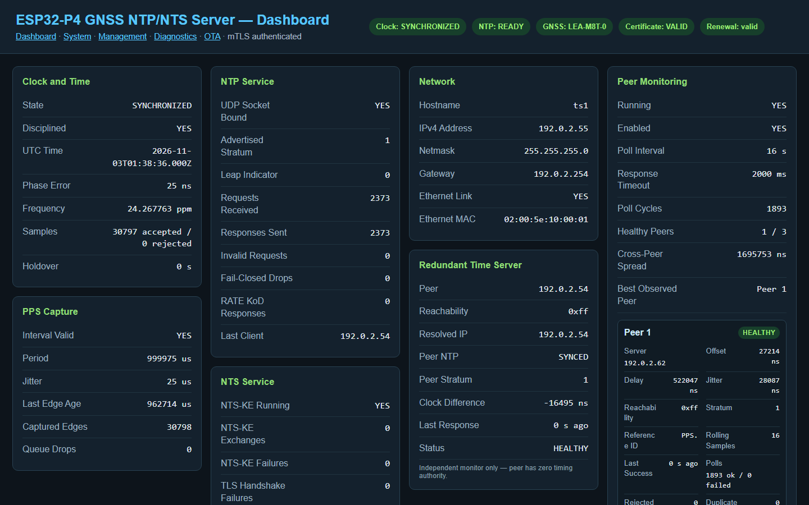
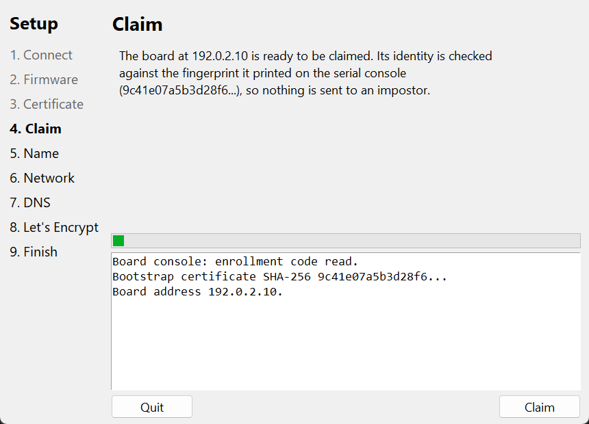
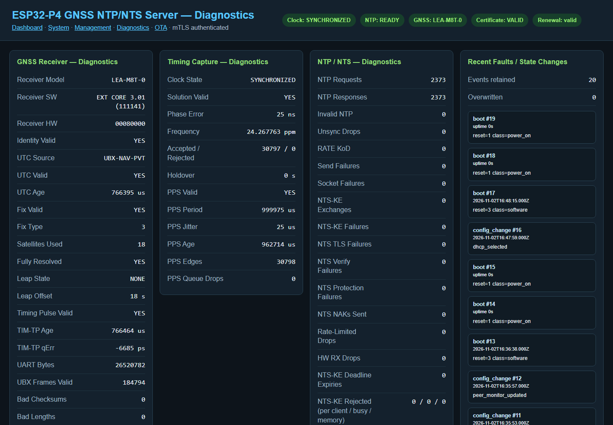

---
hide:
  - navigation
  - toc
---

# ESP32-P4 GNSS Time Server

<section class="hero">
  
Stratum 1 · NTP and NTS · Free and open source

  
Your own stratum-1 time server, accurate to microseconds.

  
A network time server built on the ESP32-P4. A u-blox timing receiver disciplines the clock from GNSS and its pulse-per-second output, and the Ethernet MAC's hardware timestamps keep the served time accurate at the wire.

  

    <a class="md-button md-button--primary" href="https://github.com/optimusprime-nn/esp32p4_nts_time_server/releases/latest">Download</a>
    <a class="md-button" href="getting-started/what-you-need/">Get started</a>
  

  
Release 3.1.12 · Setup tool for Windows and Linux · ESP32-P4 silicon v1.x and v3.x

  
</section>

  
<b>&lt; 50 ns</b>typical clock phase error

  
<b>±10 µs</b>board-to-board agreement

  
<b>91 h</b>soak, 0 rejected PPS samples

  
<b>99.998%</b>of NTP requests answered

  

    <h3>Stratum 1, honestly</h3>
    
Stratum 1 while locked to GNSS, stratum 2 in holdover, 16 otherwise. It never claims time it cannot support.

  

  

    <h3>NTS built in</h3>
    
Authenticated time (RFC 8915) with key exchange on port 4460, next to plain NTP on port 123.

  

  

    <h3>Certificates look after themselves</h3>
    
It gets and renews its own Let's Encrypt certificate through Cloudflare DNS, and switches to the new one by itself.

  

  

    <h3>Hardware timing</h3>
    
PPS is captured in hardware at 50 ns resolution, and NTP packets are timestamped by the Ethernet MAC, not by software.

  

  

    <h3>Locked-down management</h3>
    
The console and API answer only to the client certificate you create during setup. Each board makes its own key at first boot.

  

  

    <h3>Safe updates</h3>
    
New firmware goes into a spare slot over the network. An image that fails in its first 5 minutes is rolled back automatically.

  

<section class="split">
  

    <h2>Set up in a few clicks</h2>
    
The setup tool takes a new board all the way to a working server:

    <ul>
      <li>reads the chip revision and writes the matching firmware;</li>
      <li>claims the board over a connection pinned to its fingerprint;</li>
      <li>sets its name, address and DNS servers;</li>
      <li>creates the Cloudflare record and gets the certificate;</li>
      <li>installs your administrator certificate and shows how to open the console.</li>
    </ul>
    
<a href="setup-tool/">More about the setup tool</a>

  

  
</section>

<section class="split">
  
  

    <h2>See everything it is doing</h2>
    
The web console shows the clock, PPS, GNSS receiver, NTP and NTS counters, peers, certificate and recent events, refreshed every few seconds:

    <ul>
      <li><strong>Dashboard</strong> for the state of the clock and the services;</li>
      <li><strong>System</strong> for resets, storage, the certificate and reboot;</li>
      <li><strong>Management</strong> for names, network, peers, backup and hardware;</li>
      <li><strong>Diagnostics</strong> for every counter, and a bundle to download;</li>
      <li><strong>Firmware</strong> for updates and rollback.</li>
    </ul>
    
<a href="using/web-console/">Tour the web console</a>

  

</section>

<section class="start">
  <h2>Start in an afternoon</h2>
  <ol>
    <li>Get the <a href="getting-started/what-you-need/">parts</a>: an ESP32-P4 board, a u-blox M8 receiver such as the LEA-M8T and an antenna with a view of the sky.</li>
    <li><a href="getting-started/download/">Download</a> the release and run the setup tool.</li>
    <li>Point your computers at it and <a href="getting-started/verify/">check that it works</a>.</li>
  </ol>
  
<a class="md-button" href="getting-started/what-you-need/">Read the documentation</a>

</section>

## Measured performance

From a 91-hour soak of two boards on 3.1.8, with no reboots. Later releases up to
3.1.12 do not change the clock discipline code.

| Measure | Result |
|---|---|
| PPS samples | About 327,700 per board, 0 rejected, 0 s in holdover |
| Clock phase error | Typically under 50 ns |
| Offset against an independent GPS/PPS reference | 6-hour medians between −50 and +17 µs |
| Board-to-board agreement (hardware timestamped) | Within about ±10 µs |
| NTP requests answered | 56,807 of 56,808 |
| NTS failures | 0 (light traffic: 7 authenticated requests) |

On 3.1.4, both boards also ran cleanly through a GPS leap-second table event.

## Where to start

| You want to | Read |
|---|---|
| Set up a new board with the release download | [What you need](getting-started/what-you-need.md), then [Quick setup with the tool](setup-tool/index.md) |
| Build and flash from source with ESP-IDF | [Building from source](building.md), then [Manual setup](getting-started/manual-setup.md) |
| Point computers at the server | [Pointing clients at it](using/clients.md) |
| Update firmware | [Firmware updates and rollback](using/firmware-updates.md) |
| Script against the board | [Management API](reference/api.md) |
| Fix a problem | [Troubleshooting](help/troubleshooting.md) |

!!! warning "Read before setting up a board"
    Writing the firmware to a new board turns on flash encryption at its first
    boot. That burns a key into the chip's eFuses and **cannot be undone**. See
    [Security model](help/security.md).

The source code, issue tracker and releases are on
[GitHub](https://github.com/optimusprime-nn/esp32p4_nts_time_server). The project
is licensed under the GNU General Public License v3.0.
