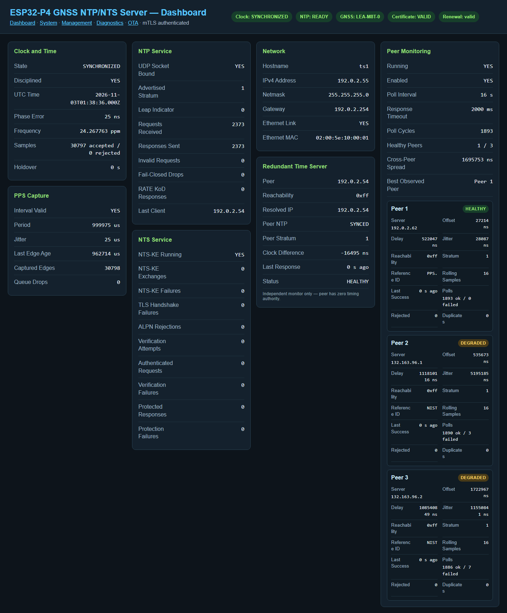
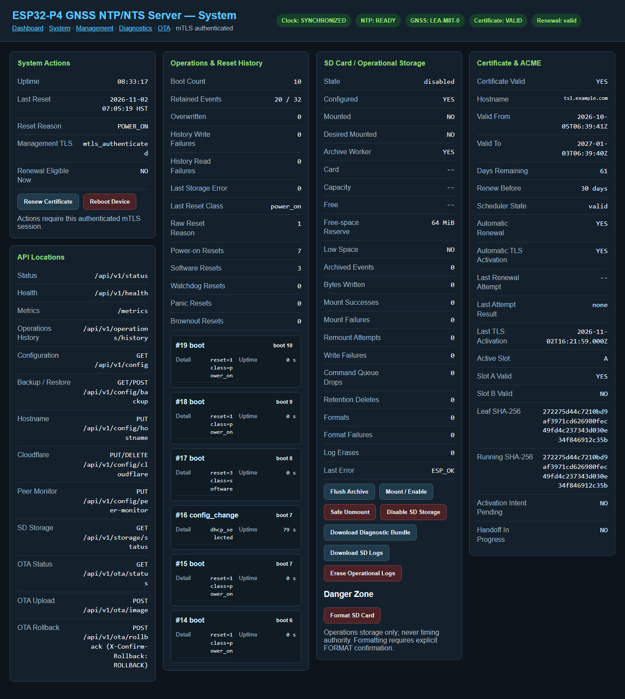
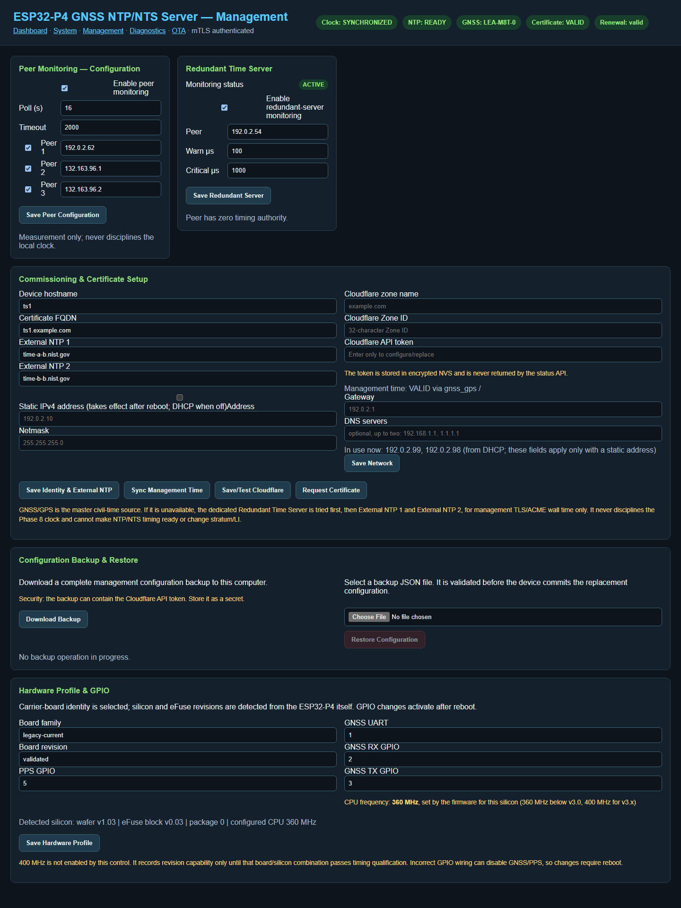
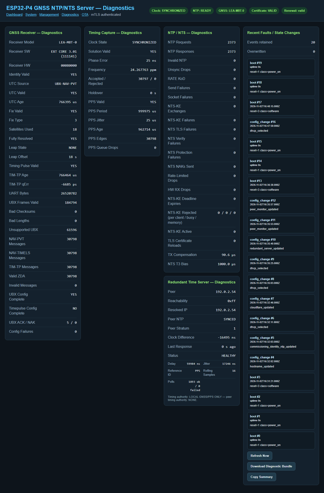
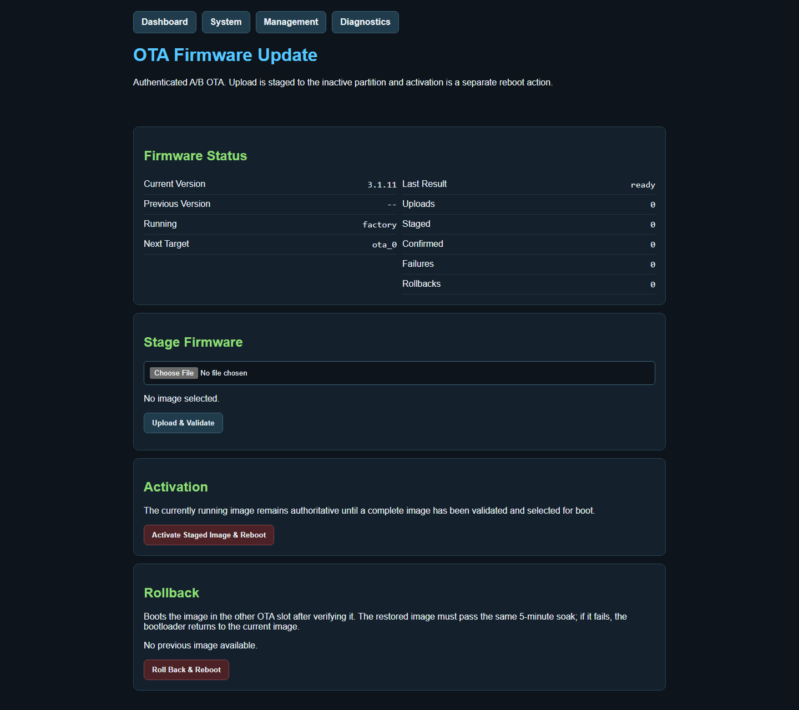

# The web console

Browse to `https://ts1.example.com/` and choose your `ntp-admin` certificate when
the browser asks. Without that certificate the board refuses the connection.

The links at the top move between five pages: **Dashboard**, **System**,
**Management**, **Diagnostics** and **OTA** (the Firmware page). Pages refresh
themselves every few seconds; a refresh pauses while you are typing in a form.

## Header badges

| Badge | Meaning |
|---|---|
| Clock | Clock state: `SYNCHRONIZED`, `ACQUIRING`, `HOLDOVER`, `UNSYNCHRONIZED` or `FAIL_CLOSED` |
| NTP | `READY` when the server is answering with good time |
| GNSS | The receiver model, or `IDENTITY PENDING` until the receiver has identified itself |
| Certificate | `VALID`, `INVALID`, or `NOT CONFIGURED` before Let's Encrypt |
| Renewal | The certificate renewal scheduler's state |

## Dashboard (`/`)

<figure markdown="span">
  { loading=lazy }
  <figcaption>The Dashboard of a synchronized board. Names and addresses are examples.</figcaption>
</figure>

| Card | What it shows |
|---|---|
| Clock and Time | State, whether the clock is disciplined, current UTC, phase error, frequency correction, accepted and rejected samples, seconds in holdover |
| PPS Capture | Whether the pulse-per-second interval is valid, its period and jitter, the age of the last edge, edge count, queue drops |
| NTP Service | Socket bound, advertised stratum and leap indicator, requests, responses, invalid requests, fail-closed drops (requests not answered because the clock was not good enough), `RATE` Kiss-o'-Death replies, last client |
| NTS Service | Whether NTS key exchange is running, key exchanges and failures, TLS handshake failures, ALPN rejections, authenticated requests, verification and protection failures |
| Network | Hostname, IPv4 address, netmask, gateway, link state, MAC address |
| Redundant Time Server | The other board: reachability, its stratum, clock difference, last response, status. See [Two servers](redundancy.md) |
| Peer Monitoring | General peer monitor state and one box per configured peer |

## System (`/system`)

<figure markdown="span">
  { loading=lazy }
  <figcaption>System: actions, reset history, SD card storage and the certificate.</figcaption>
</figure>

| Card | What it shows and does |
|---|---|
| System Actions | Uptime, last reset and its reason, management TLS mode, whether a renewal is due. **Renew Certificate** asks for a renewal now (refused unless within 30 days of expiry). **Reboot Device** restarts the board |
| API Locations | The main API addresses, for reference |
| Operations & Reset History | Boot count, retained and overwritten events, history storage errors, last reset class, reset counts by type, the latest six events |
| SD Card / Operational Storage | Card state, capacity and free space, archive counters. Buttons below |
| Certificate & ACME | Certificate validity, name, dates, days remaining, renewal scheduler state, automatic renewal, last attempt, active storage slot, certificate fingerprints |

**Reboot Device** is refused with a message while an OTA upload, a certificate
operation or a TLS hand-over is in progress (3.1.10 and later). Wait and try
again.

SD card buttons:

| Button | Effect |
|---|---|
| Flush Archive | Write pending events to the card now |
| Mount / Enable | Mount the card and keep SD storage enabled |
| Safe Unmount | Unmount until the next reboot. Use before removing the card |
| Disable SD Storage | Unmount and stay disabled after reboots, until **Mount / Enable** |
| Download Diagnostic Bundle | A JSON file of status and recent events. Contains no secrets |
| Download SD Logs | Choose boot logs to download, as single files or a ZIP |
| Erase Operational Logs | Delete all log files from the card. Asks you to type `ERASE` |
| Format SD Card | Erase everything on the card. Asks you to type `FORMAT` |

The SD card is for logs only. Timing never depends on it.

## Management (`/management`)

<figure markdown="span">
  { loading=lazy }
  <figcaption>Management: peers, the redundant server, identity and network, backup, and hardware.</figcaption>
</figure>

| Section | What it does |
|---|---|
| Peer Monitoring — Configuration | Turn general peer monitoring on or off, set poll interval and timeout, and up to three peers |
| Redundant Time Server | Set the other board's name and the warning and critical thresholds |
| Commissioning & Certificate Setup | Hostname, certificate DNS name, two external NTP servers, Cloudflare zone, Zone ID and token, static IPv4. Buttons: **Save Identity & External NTP**, **Sync Management Time**, **Save/Test Cloudflare**, **Request Certificate**, **Save Network** |
| Configuration Backup & Restore | **Download Backup**, and **Restore Configuration** from a backup file. See [Backup and restore](backup-restore.md) |
| Hardware Profile & GPIO | Board family and revision, PPS GPIO, GNSS UART and its RX and TX GPIOs. Shows the detected silicon revision and the CPU frequency. **Save Hardware Profile** applies after a reboot |

Notes:

- The Cloudflare token field is write-only. The board stores the token encrypted
  and never shows it again. Enter it only to set or replace it.
- A static address applies at the next reboot. A wrong address makes the
  console unreachable until it is changed back from the new address, or the
  board is reflashed. An invalid stored address falls back to DHCP.
- **Sync Management Time** sets the date used for TLS and certificates when GNSS
  has not locked. It never affects served time.
- The CPU frequency is information only. The firmware sets it for the silicon:
  360 MHz below v3.0, 400 MHz for v3.x.
- Wrong GNSS pins stop GNSS working. Change them only for a carrier board wired
  differently from the [standard pins](../reference/hardware.md).

## Diagnostics (`/diagnostics`)

<figure markdown="span">
  { loading=lazy }
  <figcaption>Diagnostics: the GNSS receiver, timing capture, every NTP and NTS counter, and recent events.</figcaption>
</figure>

| Card | What it shows |
|---|---|
| GNSS Receiver — Diagnostics | Receiver model and versions, UTC source and validity, fix type, satellites used, leap-second state and offset, timing pulse state and quantization error, message and error counters, receiver configuration state |
| Timing Capture — Diagnostics | Clock state, phase error, frequency, sample counts, holdover, PPS validity, period, jitter, age, edges, drops |
| NTP / NTS — Diagnostics | All NTP and NTS counters, including rate-limit and hardware receive drops, NTS-KE rejections by reason, active key-exchange connections, certificate reloads, learned transmit compensation and NTS transmit bias |
| Redundant Time Server — Diagnostics | The redundant peer, with delay, jitter, reference ID and poll counts |
| Recent Faults / State Changes | The last 20 events, with **Refresh Now**, **Download Diagnostic Bundle** and **Copy Summary** |

## Firmware (`/management/firmware`)

<figure markdown="span">
  { loading=lazy }
  <figcaption>Firmware: status, staging an image, activation and rollback.</figcaption>
</figure>

| Section | What it shows and does |
|---|---|
| Firmware Status | Current and previous version, running slot and next target, last result, upload, staged, confirmed, failure and rollback counts |
| Stage Firmware | Choose a `.bin` and click **Upload & Validate** |
| Activation | **Activate Staged Image & Reboot** |
| Rollback | **Roll Back & Reboot**, available when a verified previous image exists |

See [Firmware updates and rollback](firmware-updates.md).

## Before the board is claimed

Until the board is claimed, `https://<address>/` shows only a page saying
*Management enrollment required*. Nothing can be changed except by claiming the
board with the code from the serial console.
